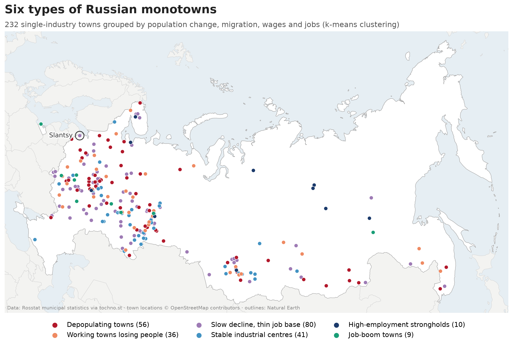

# Russian monotowns typology

**Which Russian monotowns are shrinking, and in what way?** This project groups 232 of Russia's official single-industry towns into six types using open municipal statistics on population, migration, wages and jobs. It then checks the types against the government's own rating of these towns and shows where **Slantsy** (Leningrad Oblast), the site of my bachelor's thesis, fits among its peers.

[](https://evelina-kalugina.github.io/russian-monotowns-typology/monotown_types_map.html)

**[Open the interactive map](https://evelina-kalugina.github.io/russian-monotowns-typology/monotown_types_map.html)** (hover over a town to see its name, region and type).

## Research question

Russia has 264 officially listed monotowns: towns whose economy depends on one industry or one large enterprise. Many of them are shrinking, but not all for the same reason. Some lose people through out-migration, some keep their residents but lose jobs, and a few are growing on the back of new investment.

The project asks:

1. Can monotowns be sorted into a small number of meaningful types based on demography and the local labour market?
2. Do these data-driven types agree with the official categories the government assigns to monotowns?
3. What type does Slantsy belong to, and how typical is it of that type?

## Key findings

### 1. Six types of monotowns

K-means clustering on five variables gives six types. Values are medians for each type.

| Type | Towns | Population change 2023-2025 | Net migration per 1,000 | Relative wage | Jobs per 1,000 | Job change 2017-2025 | Typical towns |
|---|---|---|---|---|---|---|---|
| Slow decline, thin job base | 80 | -1.7% | +0.5 | 1.00 | 190 | -11% | Stepnoye Ozero, Lysva, Osinniki, Rossosh, **Slantsy** |
| Depopulating towns | 56 | -3.1% | -7.0 | 0.99 | 189 | -15% | Kataysk, Kolchugino, Gus-Khrustalny, Tashtagol |
| Stable industrial centres | 41 | -1.0% | +1.7 | 1.29 | 256 | -5% | Novokuznetsk, Volodarsk, Miass, Linyovo |
| Working towns losing people | 36 | -2.5% | -3.7 | 1.24 | 284 | -5% | Rybinsk, Sarapul, Asha, Kozmodemyansk |
| High-employment strongholds | 10 | -0.4% | +0.5 | 1.34 | 487 | +10% | Severodvinsk, Norilsk, Mirny, Kirovsk, Vyksa |
| Job-boom towns | 9 | -0.5% | +2.6 | 1.30 | 343 | +65% | Kotovsk, Neryungri, Aleksin, Yelabuga, Borovsk |
| *All 232 towns* | | *-1.9%* | *-1.4* | *1.08* | *218* | *-9%* | |

Almost every type is losing population; what differs is *how*. The two largest types (136 towns together) combine population loss with weak job bases, while the smaller, better-off types keep their people through high employment or new jobs.

### 2. The types agree with the official rating

The government rates each monotown in three categories (1 = most difficult socio-economic situation, 3 = stable). The types were built without this information, yet they line up with it:

| Type | Share in category 1 (most difficult) | Share in category 3 (stable) |
|---|---|---|
| Depopulating towns | 36% | 7% |
| Working towns losing people | 22% | 31% |
| Slow decline, thin job base | 13% | 25% |
| Stable industrial centres | 7% | 39% |
| High-employment strongholds | 0% | 40% |
| Job-boom towns | 0% | 44% |

This is an independent check that the typology captures real differences between towns.

### 3. Slantsy in context

Slantsy belongs to the largest type, *Slow decline, thin job base*, and is an extreme member of it:

- **Fastest population loss in its type** (-3.2% from 2023 to 2025), yet its **registered net migration is positive** (+3.6 per 1,000, higher than 86% of the type). This mismatch is the most robust finding.
- **One of the thinnest job bases**: 139 jobs per 1,000 residents, lower than 91% of its type (type median 190).
- **Jobs have held steady** (-0.6% since 2017, better than 85% of the type), and wages are at the type level.
- **A data artefact corrected:** the raw Rosstat series shows Slantsy jumping from 32,833 to 35,258 residents between 2022 and 2023. This is not growth but the switch from the 2010 to the 2021 census basis (+7.4%, against a median of -1.3% across monotowns). The analysis therefore uses only the 2023-2025 window, where both years are on the same basis.

**Link to the thesis.** My thesis proposes a geology research institute and museum in Slantsy with about 300 jobs. That equals **about +5% (+4.9%)** of the 6,064 employees at large and medium organisations in the Slantsy district, raising jobs per 1,000 residents from 139 to 146. The project targets the town's weakest point, but as a noticeable rather than transformative addition; its main value lies in qualified jobs that could attract and keep young residents.

## Method

1. **Town list.** The 264 monotowns from Government Order No. 469-r of 11 March 2026, with their official categories.
2. **Matching.** Each town was matched to its OKTMO code in the Rosstat municipal database (247 matched, 17 excluded; see Limitations). Municipalities that were merged or reorganised received new codes, so old and new codes were linked by hand.
3. **Variables.** Five indicators per town:
   - population change 2023-2025 (same census basis);
   - average net migration 2021-2023 per 1,000 residents;
   - average wage relative to the regional median of municipal districts and okrugs;
   - employees of large and medium organisations per 1,000 residents (2025);
   - change in those employees, 2017-2025.
4. **Preparation.** 232 towns with complete data. Extreme values were capped at the 2nd and 98th percentiles (winsorizing), then all variables were standardised so each has equal weight.
5. **Clustering.** K-means for k = 2 to 8, compared by silhouette score and interpretability. Six clusters were chosen (silhouette 0.24, 50 random starts) and named after their typical profile.
6. **Validation and context.** Types were compared with the official categories, and Slantsy was placed within its type using percentile ranks.
7. **Maps.** Towns were geocoded with OpenStreetMap Nominatim and drawn as an interactive Folium map and a static map in an equal-area projection.

## Repository structure

```
data/
  monotowns_2026.csv        264 towns from Order No. 469-r
  names_en.csv              English names and regions
  processed/                cleaned indicators, features.csv, clusters.csv, coords.csv
  raw/                      raw Rosstat downloads (not on GitHub, see below)
docs/
  monotown_types_map.html   interactive map (published with GitHub Pages)
figures/
  monotown_types_map.png    static map
notebooks/
  00_setup_test.ipynb       environment check
  01_load_data.ipynb        load and clean the raw indicators
  02_match_oktmo.ipynb      match monotowns to OKTMO codes
  03_features.ipynb         build the clustering variables
  04_clustering.ipynb       clustering, type profiles, official categories, Slantsy in context
  05_maps.ipynb             geocoding, interactive and static maps
```

## How to reproduce

The processed data is included, so notebooks 04 and 05 run straight after cloning. To rebuild everything from raw data:

1. **Set up the environment** (Anaconda, Python 3.11):
   ```
   conda create -n urban -c conda-forge python=3.11 pandas geopandas scikit-learn matplotlib seaborn folium geopy jupyterlab
   conda activate urban
   jupyter lab
   ```
2. **Download the raw data** from [tochno.st/datasets/bdmo](https://tochno.st/datasets/bdmo): the population, migration, wage and employee files for the years in the table below. Put them in `data/raw/`, and the Leningrad Oblast population file (all years) in `data/raw/slantsy/`.
3. **Run the notebooks in order**, 01 to 05, each with *Kernel > Restart Kernel and Run All Cells*.

Notebook 05 geocodes only towns missing from `data/processed/coords.csv`, so it does not query Nominatim again on a normal run. On Windows, notebook 04 sets `OMP_NUM_THREADS=1` before importing scikit-learn to avoid a known KMeans memory warning.

## Data sources

| Data | Source | Years used |
|---|---|---|
| Population estimate on 1 January | Rosstat municipal database (BDMO), via the dataset "Municipal statistics of Russia since 2005" by *Esli byt' tochnym* ([tochno.st](https://tochno.st/datasets/bdmo)) | 2023, 2025 (clustering); 2017, 2022 (census check); all years for Slantsy |
| Net migration | same | 2021-2023 |
| Average monthly wage, organisations excluding small and medium businesses | same | 2025 |
| Average number of employees, organisations excluding small and medium businesses | same | 2017, 2025 |
| Employees by industry (mining, manufacturing) | same | 2017, 2025 (explored, not used) |
| List and categories of monotowns | Order of the Government of the Russian Federation No. 469-r of 11.03.2026 (in force from 01.06.2026) | 2026 |
| Town locations | © [OpenStreetMap](https://www.openstreetmap.org/copyright) contributors, via Nominatim | 2026 |
| Country outlines | [Natural Earth](https://www.naturalearthdata.com/) 1:50m admin-0 countries (public domain) | downloaded 2026 |
| Interactive map tiles | Esri World Light Gray Canvas | 2026 |

## Glossary

| Term | Meaning |
|---|---|
| **Monotown** (*monogorod*) | An officially listed single-industry town, where one industry or enterprise dominates local employment. |
| **Monotown categories 1 / 2 / 3** | The official rating in Order No. 469-r: 1 = most difficult socio-economic situation, 2 = risk of deterioration, 3 = relatively stable. |
| **OKTMO** | All-Russian Classifier of Territories of Municipal Formations: the code that identifies each municipality in statistics. |
| **BDMO** | Rosstat's Database of Municipal Indicators, the main source of town-level statistics in Russia. |
| **Municipal district** (*munitsipalny rayon*) | A municipal unit made up of a town and surrounding rural settlements. |
| **Municipal okrug** (*munitsipalny okrug*) | A single-tier unit that replaced many districts after recent reforms; one okrug often covers a town and its former district. |
| **Urban settlement** (*gorodskoye poseleniye*) | The lowest-level municipality: a town, sometimes with a few nearby villages. |
| **ZATO** | Closed administrative-territorial formation: a "closed town" with restricted access (often nuclear or military), with limited published statistics. |
| **Census rebasing** | Rosstat recalculates population estimates after each census. Estimates up to 1 January 2022 use the 2010 census, from 1 January 2023 the 2021 census, so the two parts of the series are not directly comparable. |
| **Net migration** | Registered arrivals minus registered departures. |
| **Implied natural change** | Population change minus net migration: a rough estimate of births minus deaths. |
| **Winsorizing** | Capping extreme values at chosen percentiles (here 2nd and 98th) so outliers do not dominate the clustering. |
| **Standardisation** | Rescaling each variable to mean 0 and standard deviation 1 so all variables count equally. |
| **K-means** | A clustering method that splits observations into *k* groups so that each one is as close as possible to its group's average profile. |
| **Silhouette score** | A measure from -1 to 1 of how well separated the clusters are; values around 0.2-0.3 mean overlapping groups. |
| **Geocoding** | Converting a place name into map coordinates. |

## Limitations

**Coverage**
- 17 of the 264 monotowns are excluded: 9 in the DNR, LNR and Zaporozhye Oblast (not in the Rosstat database), 7 ZATO (closed towns), and one where the only available unit was too broad. A further 15 towns lacked one or more variables, leaving 232.
- For 6 towns, data exist only for the surrounding municipal district, used as a proxy for the town.

**Measurement**
- The census rebasing between 2022 and 2023 breaks the population series, so population change covers only two years (2023-2025). This short window may still contain post-census corrections.
- Migration counts only registered moves. People who leave without deregistering are missed, which may explain why Slantsy loses population despite positive registered migration.
- Implied natural change is a rough residual and is not proof of ageing; for Slantsy (-20 per 1,000 per year) it is too large to be ageing alone.
- Jobs and wages cover only large and medium organisations, not small businesses or self-employment.
- Relative wage compares a town with its own region, so it does not show differences in living costs or absolute income between regions.
- Industry structure was dropped: mining and manufacturing figures are confidential for most towns (both published for only 40 of 232).
- The data unit can differ between indicators: for Slantsy, population refers to the urban settlement and jobs to the whole district. Some towns in Yakutia's diamond-mining area share district-level values.
- Indicators come from different years (migration 2021-2023, wages 2025, jobs 2017 and 2025).

**Method**
- The types overlap (silhouette 0.24): they describe tendencies, not sharp groups. Towns near the border between two types could reasonably belong to either, and the two smallest types have only 9 and 10 towns.
- The maps show geocoded points, not municipal boundaries.

## Author

Evelina Kalugina, BA Environmental and Interior Design with a minor in Urban Development, HSE University.

Licence: [MIT](LICENSE).
